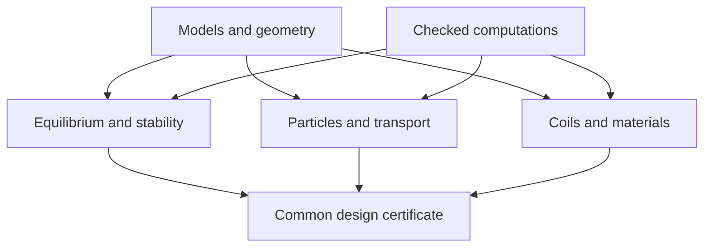

# PlasmaLean roadmap: from foundational lemmas to practical design

Prepared against commit `466920416e97561e4669759ab4077b9a23281ebd` on 10 October 2026. The repository is at the starter stage. This roadmap describes work to do; it does not mark the proposed modules or certificates as implemented.

## Contents

- [Success criteria](#success-criteria)
- [Parallel mathematical tracks](#parallel-mathematical-tracks)
- [Milestones and evidence gates](#milestones-and-evidence-gates)
- [The first coding sequence](#the-first-coding-sequence)
- [Substantial existing mathematics to formalize](#substantial-existing-mathematics-to-formalize)
- [Ambitious research problems](#ambitious-research-problems)
- [AI theory-development loop](#ai-theory-development-loop)
- [Progress records](#progress-records)

## Success criteria

A useful final artifact is a concrete coil/plasma/component design with:

1. a mathematical model of its fields and equilibrium;
2. the specified plasma stability and confinement/transport bounds;
3. continuous geometric and engineering margins;
4. operating/manufacturing/material uncertainty handled with correct quantifiers;
5. explicit model/data assumptions and evidence for their applicability;
6. Lean declarations and checked certificates attached to one decoded candidate.

The final scientific claim is as strong as that conjunction and the validated applicability of its models. Keep optional goals such as global optimality separate. Proving feasibility of one valuable design is already a substantial outcome.

Use task labels:

- **F — Formalization:** an established theorem or elementary deduction, after exact source/hypothesis extraction.
- **V — Validation development:** a new checker or constructive estimate connecting numerical candidates to an established mathematical theorem.
- **R — Research:** a new theorem or a substantial unresolved instance/class needed for stronger design claims.

An **R** label is a proposed research target, not an assertion that every related problem is open. Recheck the current literature before claiming novelty or unresolved status. The formulations below deliberately specify classes and weaker alternatives rather than asserting impossible universal guarantees.

## Parallel mathematical tracks

The library should develop several mathematical tracks; work in one does not depend on completing every other track.

| Track | Inputs | Principal outputs |
| --- | --- | --- |
| Geometry/fields | Curves, surfaces, current distributions | Regular charts, continuous clearance, source-free fields, perturbation norms |
| Equilibrium | Fields, profiles, boundaries | Exact smooth/weak equilibrium or validated branch |
| MHD stability | Equilibrium and perturbation/wall model | Energy identity, quotient, nonnegativity/coercivity or instability witness |
| Particle/kinetic | Field, species, electric field, collisions | Orbit-loss bound, transport/current closure, restricted kinetic stability |
| Engineering | Loads, finite conductors, material data | Heat, stress, strain, quench, shielding, lifetime margins |
| Certificates | Exact representations and analytic estimates | Sound numerical checkers and robust composition |

Dependency structure:

The arrows are proof interfaces, not merely software imports. Bootstrap current, deformation, and heat sources also create feedback loops; close them with a common solution or controlled error/envelope theorem.

## Milestones and evidence gates

| Gate | Work / status class | Required reviewable artifact | Claim available at this gate |
| --- | --- | --- | --- |
| P0: honest kernel | F | Model predicates, assumption ledger, consistent simple instances, actual module inventory | The model definitions have checked elementary consequences |
| P1: useful exact building blocks | F/V | Tangency, energy/form lemmas, interval containment, Biot–Savart estimates, slab/bar/ribbon examples | Selected mathematical and component claims |
| P2: continuous vacuum candidate | V | Concrete coil representation, embedding/clearance certificate, field/derivative enclosures, source-distance margins | The specified coil geometry and vacuum-field properties |
| P3: confined reduced orbits | F/V/R | A certified invariant barrier or finite-time orbit bundle, initial set, model/reduction error | The declared field-line or particle confinement property |
| P4: finite-pressure equilibrium | F/V/R | Exact or validated equilibrium with boundary, profiles, flux/current constraints and regularity | A real solution of the chosen smooth/weak plasma model exists nearby |
| P5: all-mode MHD result | F/V/R | Correct perturbation space, closed form/operator bridge, all-mode bounds, boundary terms, uncertainty margin | The specified fixed/free-boundary linear stability conclusion |
| P6: kinetic and exhaust closure | F/V/R | Bootstrap/ambipolar branch, heat/particle loss bounds, kinetic-mode scope, exhaust source envelope | The selected transport and kinetic operating bounds |
| P7: buildable component system | F/V | Finite winding packs, peak conductor field, strain/stress, temperatures, quench, irradiation/life and access | Feasibility under the supplied component/load/material models |
| P8: robust integrated candidate | V/R | Common equilibrium/component witnesses for all declared uncertainty states; coupled feedback closure | The conjunction of verified mathematical design contracts |
| P9: practical design basis | Mathematical work plus empirical/engineering validation | Comparisons to experiments, validated material envelopes, tolerance/metrology plan, service/power/tritium budgets | A design basis with explicit proved content and model-validity evidence |

These gates need not be completed in table order. For example, component theory can proceed from conservative load envelopes while the MHD theorem is still under development. A vacuum demonstrator can be an achievable product before a finite-beta reactor design.

At P5, accept a sound nonnegative-energy/observable conclusion if a full positive spectral gap is mathematically unavailable; name the conclusion accurately. At P8, a fixed-boundary result cannot silently become free-boundary stability.

## The first coding sequence

Use the six project skills. Read [00](00-model-contracts.md) for contracts and [09](09-literature.md) for sources.

| Order | Proposed module | First declaration targets | Acceptance criterion |
| --- | --- | --- | --- |
| 1 | `Kernel.Equilibrium`, `Sanity.Equilibrium` | `MHDEquilibrium`, field/current tangency, constant-field witness, force-free nonvacuum example | Compiles; no new project axioms; explicit hypotheses and nonvacuity |
| 2 | `Theory.Stability.AbstractEnergy` | Symmetric/inertia forms, conditional energy conservation, coercivity bound, zero-mode example | Correct norm and time/existence scope |
| 3 | `Certificates.RationalIntervals` | Exact coefficient decoder, interval operations, arithmetic soundness | Valid and invalid certificate fixtures |
| 4 | `Theory.Geometry.ParametricBounds` | Between-sample Lipschitz bound, Fourier derivative bounds, continuous curve clearance | Entire parameter domain covered |
| 5 | `Theory.Engineering.SlabHeat` | Slab solution, maximum, uncertainty monotonicity, temperature margin | Exact arithmetic plus explicit supplied thermal laws |
| 6 | `Theory.Fields.BiotSavart` | Current linearity, source-distance field/derivative bounds, loop sanity case | Continuous integral with singularities excluded |
| 7 | `Theory.Stability.BlockBounds` | Retained/tail positivity and quantitative margin | Cross terms included; no MHD tail claim yet |
| 8 | `Bridge.Candidate`, `Design.Specification` | Typed identity, common witness, assumption/certificate ledger | Changed geometry cannot reuse incompatible evidence |

Then select one short end-to-end example: a documented simple coil field with certified geometry plus a reduced orbit property, or a thermal/material component bound linked to a sourced load envelope. Keep mathematical toy examples and physical candidate examples labelled separately.

Compile only the Lean code actually written. These Markdown specifications are not evidence that a future declaration compiles. Search the pinned Mathlib/TauCeti sources before committing to analytic API dependencies.

## Substantial existing mathematics to formalize

1. Flux-form/divergence equivalence, pressure-surface topology under complete hypotheses, Boozer reciprocal-basis identities.
2. Fixed-boundary MHD linearization and energy principle with a modern closed form/operator formulation.
3. Source-specific local interchange/ballooning criteria.
4. Noether invariants and the precise quasisymmetry/omnigeneity implications in reduced guiding-centre dynamics.
5. A posteriori invariant-torus/KAM results with explicit nondegeneracy and Diophantine constants.
6. Piecewise smooth toroidal MHD existence theorems, particularly Enciso–Luque–Peralta-Salas.
7. Generic validated fixed-point, ODE, PDE and form/eigenvalue bounds in the function spaces actually used.
8. Conservation/positivity/coercivity results for heat, elasticity, circuits, and transport/inventory models.

Formalize theorem prerequisites in reusable mathematical libraries where appropriate. A physical law in a typeclass is not a substitute for any of these derivations.

## Ambitious research problems

### R1. Constructive three-dimensional finite-pressure equilibrium

For a specified genuinely nonaxisymmetric toroidal geometry and nonconstant pressure/current class, prove an a posteriori existence theorem with explicit, usable constants, including small-divisor/resonance compatibility, boundary conditions, and profile constraints. Validate a solution or branch generated by a real equilibrium solver.

Starting points: [Enciso et al., SPEC, Boozer, and Constantin et al.](09-literature.md#geometry-equilibrium-and-symmetry). Piecewise smooth/stepped-pressure results are already available in important classes. A theorem for those classes is a useful milestone; continuously nested smooth solutions require their own analysis. If the proposed class is obstructed, characterize the obstruction and adopt a justified weak or modified model.

### R2. All-mode stability in a nonaxisymmetric practical class

Find a geometry-sensitive sufficient condition for nonnegative or quantitatively controlled ideal-MHD energy on the correct admissible space, with a free plasma boundary when required. Handle neutral modes and continuous spectrum instead of assuming a generic elliptic spectral gap.

Target a physically useful finite-beta/current range and coil tolerance budget. A robust observable bound or restricted perturbation theorem may be more appropriate than coercivity in the full `H¹` norm.

### R3. Nonlinear stability with a useful basin

Establish a constrained conserved/Lyapunov functional controlling an appropriate distance to a three-dimensional equilibrium family, including a quantitative nonlinear remainder and well-posedness/continuation assumptions. For an all-time result, prove the needed continuation rather than assuming that the linear energy calculation prevents singularities.

A major target is a model/class with global orbital control; a finite-time nonlinear bound under quantified regularity is an intermediate result. Do not present arbitrary three-dimensional ideal-MHD global regularity as a routine library task.

### R4. Quantitative imperfect-symmetry confinement and transport

Relate a derivative-sensitive quasisymmetry/omnigeneity defect and field perturbation to finite-time loss or a loss-measure bound for a specified energetic-particle initial distribution. Handle or explicitly exclude separatrix/resonance classes and include finite-gyroradius/reduction error.

Then connect the defect to a rigorous neoclassical transport/current bound in the relevant collision regime. An `L²` symmetry objective alone is not the desired theorem.

### R5. Geometry-based kinetic stability and heat-flux bounds

Extend restricted maximum-`J`/energy results to a specified multispecies, gradient, collision, electromagnetic and forcing regime. Prove bounds on growth or nonlinear time-averaged heat flux useful in the operating envelope, rather than requiring every microinstability to vanish.

Couple the result to profile evolution and exhaust. This is a substantial open research direction, and a verified reduced model with explicit limitations is worthwhile progress.

### R6. Controlled model reduction for design

Prove explicit finite-time and norm/observable error bounds between full Lorentz and guiding-centre trajectories, between kinetic and selected fluid/profile models, or between finite-width conductors and filament models. Transfer certificates through margins exceeding these errors.

Singular limits, collisions, boundaries, and long operating horizons can invalidate naive perturbation arguments. Start with restricted smooth regimes and strengthen only through proved estimates.

### R7. Coupled robust operation and lifetime

Construct an invariant operating set or a time-dependent safe envelope for the coupled plasma/current/heat/stress/material evolution under bounded disturbances and a specified controller. Account for profile response, coil deformation, critical-current change, erosion and irradiation degradation.

Prove feasibility for all histories in the declared input class and return a conservative service interval. Statistical material data and model discrepancy remain explicit interfaces.

### R8. Scalable proof certificates for practical resolution

Develop proof-producing compressed certificates that scale to realistic coil geometry, equilibrium modes, transport discretizations, and material meshes. Prove decoding, domain coverage, tail/control estimates and soundness; use GPU/AI search to generate certificates without enlarging the trusted mathematical boundary.

These targets can reveal new mathematics rather than merely reimplement numerical codes.

## AI theory-development loop

For each missing design implication:

1. State a precise useful lemma and its assumptions.
2. Search/extract the closest existing theorem.
3. Try a proof and look for counterexamples.
4. Repair an overbroad claim by a justified hypothesis or weaker conclusion.
5. Formalize a complete proof; prove limiting cases and useful corollaries.
6. Attach its quantitative output to the next design contract.
7. Repeat, or record a precise obstruction/research problem.

Use experiments to find structure, witnesses, and failures. Preserve the priority on theoretical advances. Do not replace theory with repeated floating-point optimization when the missing step is an all-mode inequality or a continuum existence theorem.

## Progress records

Keep a table of task ID, mathematical statement, dependencies, source locator, assumptions, status, declaration, build result, example certificate, margin, and next task. Mark `proved informally`, `published theorem extracted`, `Lean verified`, `numerically observed`, and `conjectured` distinctly.

For each design candidate record the highest gate actually passed, the exact supported claims, and the remaining gaps. A proof failure can mean insufficient bounds, wrong representation, or a genuine mathematical obstruction; it is not automatically physical instability.
