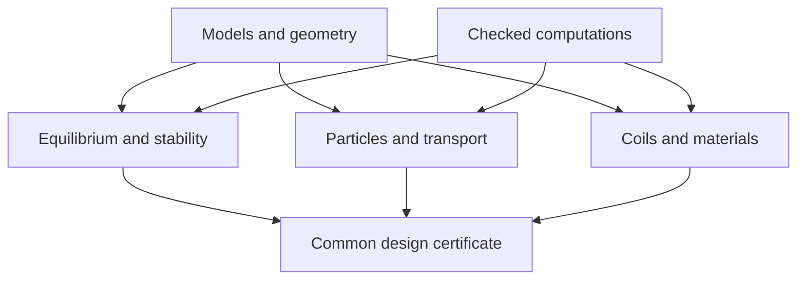

# PlasmaLean roadmap: from foundational lemmas to practical design

This roadmap was first prepared on 10 October 2026 against commit `466920416e97561e4669759ab4077b9a23281ebd`, when the repository was at the starter stage. It was rewritten on 30 October 2026 around the **stellarator contract** (clauses C1–C5) and the research graph of the [implementation plan](../implementation-plan.md#research-graph-added-29-october-2026). The plan is the record of status. This chapter explains the structure: what a finished result must contain, how goals and questions depend on each other, which evidence gates a candidate passes, and how work is run. The original gates P0–P9, the first coding sequence and the research problems R1–R8 are kept with their names, and each now has a status note. Statements about the future are targets. Statements about compiled work cite declarations that exist in `PlasmaLean/`.

## Contents

- [The stellarator contract](#the-stellarator-contract)
- [Success criteria](#success-criteria)
- [Goals and questions](#goals-and-questions)
- [Current priority order](#current-priority-order)
- [Parallel mathematical tracks](#parallel-mathematical-tracks)
- [Milestones and evidence gates](#milestones-and-evidence-gates)
- [The first coding sequence](#the-first-coding-sequence)
- [Substantial existing mathematics to formalize](#substantial-existing-mathematics-to-formalize)
- [Ambitious research problems](#ambitious-research-problems)
- [History: phases 1–16](#history-phases-116)
- [The workstation](#the-workstation)
- [Agent commands](#agent-commands)
- [AI theory-development loop](#ai-theory-development-loop)
- [Progress records](#progress-records)

## The stellarator contract

The user approved the contract on 30 October 2026, and it re-aims the project. Tokamaks rely on a large toroidal plasma current, which brings current-driven instabilities, disruptions and the need for current drive. A stellarator gets its rotational transform from the external field instead. So the target is not just any non-axisymmetric solution. It is a solution with the properties a stellarator needs, and the decisive ones concern the drifts of thermal ions and electrons. A candidate satisfies the contract when, for one decoded field and equilibrium with common witnesses:

| Clause | Requirement (short form; full text in the plan) |
| --- | --- |
| **C1** Current-free rotational transform | net toroidal plasma current ‖I_tor‖ ≤ I_max (bootstrap level; vacuum is the limiting case) and ι ≥ ι_min > 0 on the confining surfaces, provided by the external field |
| **C2** Omnigeneity for thermal particles | for thermal ions **and electrons**: zero or bounded bounce-averaged radial drift of trapped particles, or a bounded effective ripple ε_eff |
| **C3** MHD stability at finite β | Mercier, ideal ballooning and, where available, global ideal modes at a stated β > 0, with the reductions named |
| **C4** Existence | nested flux surfaces on the confining region (certified invariant tori or a validated equilibrium) and force balance J × B = ∇p |
| **C5** Thermal performance | on the same candidate: core temperature above a burn threshold over [0, T_burn] and below wall and material limits; Bosch–Hale alpha heating, bremsstrahlung, C2-derived neoclassical losses and a stated anomalous scaling |

An axisymmetric current-free field has ι = 0, so C1 excludes tokamaks, and non-axisymmetry is a *consequence* of C1, not a goal. Solov'ev results stay in the library as a tokamak model for C5 and as test beds for techniques. The Grad counterexample (`family1_grad_counterexample`) is mathematical infrastructure. The Landreman families carry net toroidal current, so they are C3/C4 test beds, not candidates (Q-18).

**Honest status (30 October 2026).** C1 is satisfied in vacuum only: the exact rational stellarator field is a vacuum field (`RationalStellarator.field_vacuum`), and its field lines stay inside a KAM-certified torus with ι ≈ 0.137 (`rationalStellarator_confined_forever_exists`). C2 is essentially open for thermal particles. C3 holds only on test beds that fail C1. C4 holds in vacuum inside one certified torus. C5 holds only on a tokamak model and in 0-D. **C2 and C5 on a stellarator candidate are essentially open.**

## Success criteria

A useful final artifact is a concrete coil/plasma/component design with:

1. a mathematical model of its fields and equilibrium (C4);
2. the specified plasma stability and confinement/transport bounds (C1, C2, C3, C5);
3. continuous geometric and engineering margins (C5 wall limits; [07](07-materials-and-engineering.md));
4. operating/manufacturing/material uncertainty handled with correct quantifiers;
5. explicit model/data assumptions and evidence for their applicability;
6. Lean declarations and checked certificates attached to one decoded candidate.

Under the contract this conjunction is goal **G-8**: C1–C5 with common witnesses, then coils and engineering margins. The final scientific claim is as strong as that conjunction and the validated applicability of its models. Keep optional goals such as global optimality separate. Proving feasibility of one valuable design is already a substantial outcome. Only the composition layer exists today (`Bridge/Contracts`: `DesignContracts`, `RobustDesign`, `compose_branch`, `incompatible_witnesses`).

Use task labels:

- **F — Formalization:** an established theorem or elementary deduction, after exact source/hypothesis extraction.
- **V — Validation development:** a new checker or constructive estimate connecting numerical candidates to an established mathematical theorem.
- **R — Research:** a new theorem or a substantial unresolved instance/class needed for stronger design claims.

An **R** label is a proposed research target, not an assertion that every related problem is open. Recheck the current literature before claiming novelty or unresolved status. The formulations below deliberately specify classes and weaker alternatives rather than asserting impossible universal guarantees.

## Goals and questions

The roadmap is now a research graph with stable identifiers: goals `G-*`, questions `Q-*` and research notes `N-*`, registered in the plan ([RG.1](../implementation-plan.md#rg1-goal-registry), [RG.2](../implementation-plan.md#rg2-question-registry), RG.3). A dependency counts as **established** only when its required output is a named compiled Lean declaration using standard axioms only. On-demand modules (built and axiom-checked on the workstation, spot-checked on the laptop) are marked as such. The tables below summarize the registries on 30 October 2026. The plan has the full rows, evidence and barriers.

| Goal | Meaning | Status |
| --- | --- | --- |
| G-1 | Current-free confinement (C1 + C4) | active, partial (vacuum): `RationalStellarator.field_vacuum`, `rationalStellarator_confined_forever_exists`; passing alpha guiding centres `alpha_gc_passing_confined_forever`, `alpha_gc_confined_forever_robust`, `alpha_gc_confined_forever_pm` (Littlejohn model supplied). Needed: ι ≥ ι_min on a nested family of tori; a finite-β current-free equilibrium |
| G-2 | Thermal performance = C5 | active (tokamak model and 0-D only): `m1_burn_window`, `Design/BurnWindowStellarator`, `solovev_one_plasma_actual` (transport solution supplied, pressure budget); obstructions `stellaris_measured_fren_no_access_steady`, `stellaris_measured_fren_no_access_loss` |
| G-3 | Model adequacy and probabilistic goals (plan §12) | proposed; nothing in Lean |
| G-4 | Finite-β stable current-free equilibrium (C1 + C3 + C4) | active, no current-free candidate: `family2_mercier_stable_derived` and `family1_mercier_unstable` on current-carrying test beds; ballooning reduced to one certificate (`family2_stable_of_cert`) |
| G-5 | Coil-produced confinement | active; all-time blocked (Q-2): `coil_stellarator_confined_concrete_N` (52 transits, field-line existence assumed) |
| G-6 | Robust alpha confinement (the alpha part of C2) | active: `alpha_gc_passing_confined_forever_quarter` (on-demand), `alpha_trapped_reactorQA_averaged` (passing alphas, near-axis QA, 0.19 s, off the axis) |
| G-7 | Verified plasma evolution (plan §11) | proposed; gate E1 done |
| G-8 | Integrated candidate, C1–C5 with common witnesses | open: `Bridge/Contracts` only |
| G-9 | Auditable certificates within the laptop budget (auxiliary) | active: certificate tactics `kernel_fact`, `bool_cert`, `eval_cert`, `fiv_cert` and the Kronecker certificates |
| G-10 | Omnigeneity for thermal particles (C2) | open: only adjacent results (`WeakQS`, `qsDefect`, `family1_not_weakQS`, `family2_not_weakQS`, `boozerGC_trapped`) |
| G-11 | Contract infrastructure: Lean definitions for C1, C2 and a contract record | open; specifications in [00](00-model-contracts.md) |

| Question | Short statement | Serves | Status |
| --- | --- | --- | --- |
| Q-1 | Trapped 3.5 MeV alphas in near-QA (per-bounce remainder) | G-6, G-10 | open, parked; `reference_kick_osc`, `exactQA_kick_osc` |
| Q-2 | Coil-produced all-time confinement via a refitted KAM torus | G-5 | blocked; on-demand `CoilKamCert` is vacuous |
| Q-3 | Family-2 ballooning certificate | G-4 (technique) | open; reduction compiled |
| Q-4 | Wider energy window and B₀R₀ range for passing alphas | G-6 | open (workstation route) |
| Q-5 | Passing confinement beyond λ = 1/4 | G-6 | open |
| Q-6 | Explicit certificates for the Landreman outer arcs | G-9 | done (`f2_arc_cert`, 30 October) |
| Q-7 | Gates E2–E3: Pizzocchero–Tassi Proposition 4.3, certified trajectory | G-7 | open, not started |
| Q-8 | Gate E4: toroidal-domain continuation | G-7 | open, not started |
| Q-9 | Helical MHD regularity | G-7 | open (research); conditional `riccati_le_initial` only |
| Q-10 | Gates E5–E6: transport existence, pressure matching, relative entropy | G-2, G-7 | open; 1-D identity compiled (`relEnt_pointwise_identity`, `old_identity_false`) |
| Q-11 | Gates E7–E8: compatible numerics, integration | G-7, G-8 | open |
| Q-12 | Remaining opaque leaves and `decide +kernel` lines | G-9 | active |
| Q-13 | Removing the burn obstruction by profile peaking | G-2 (C5) | open; obstructions proved |
| Q-14 | Stepped pressure across the exact KAM torus | G-4, Q-20 | open (lead route) |
| Q-15 | Transport barriers on non-axisymmetric geometry | G-2 | open |
| Q-16 | A quasisymmetric current-free field (C1 + C2); vacuum criterion decided | G-1, G-10 | open (research) |
| Q-17 | A Lean Grad counterexample (infrastructure) | G-4 | family 1 verified (`family1_grad_counterexample`); family 2 and τ-extension open |
| Q-18 | Net toroidal current of the Landreman families | G-1, G-4 | open; family 2 essentially answered from `torCurrent_eq`, `F1_pos`, `Eint_pos` (corollary not yet named) |
| Q-19 | Bounce-averaged drift and ε_eff for the rational vacuum field | G-10 | open |
| Q-20 | A finite-β current-free equilibrium | G-4, G-8 | open (research) |
| Q-21 | Lean definitions for C1 and C2, with the sanity triad | G-11, G-10 | open; specification written |
| Q-22 | Thermal neoclassical transport bounds feeding C5 | G-2, G-10 | open |
| Q-23 | Quasisymmetry ⇒ omnigeneity, exact and quantitative (the C2 bridge) | G-10, G-2 | open; lean-ready in the Boozer guiding-centre model (`helicalMomentum_conserved`, `boozerGC_trapped`) |
| Q-24 | Existence of strongly quasisymmetric non-symmetric fields in a volume | Q-16 | open mathematics; not on the critical path |

Main contract edges (plan RG.3): Q-21 → (Q-19, Q-16, Q-18) → G-10, G-1; Q-14 → Q-20 → G-4; G-10 → Q-22 → Q-15 → G-2; (G-1, G-4, G-10) → G-8.

## Current priority order

The priority order is plan RG.5, approved by the user on 30 October 2026. Current-free and omnigenous candidates come first, ahead of further non-axisymmetry results:

0. **Quasisymmetry ⇒ omnigeneity bridge** (Q-23, G-10): the exact bounce-average theorem and the quantitative defect bound in the Boozer guiding-centre model. It turns a certified small quasisymmetry defect into a C2 bound, so every C2 claim depends on it.
1. **Dommaschk QA fit** (Q-16, note N-27 route ii): an explicit vacuum field, current-free by construction, fitted to a quasi-axisymmetric target, with certified tori, ι ≥ ι_min and Boozer/ε_QS diagnostics. Workstation numerics come first as an untrusted oracle, then certificates.
2. **C2 diagnostics on the rational field** (Q-19): bounce-averaged radial drift and ε_eff on the certified surfaces of `RationalStellarator.field (1/4)`, to decide whether it can satisfy C2 or is only a C1 demonstrator.
3. **Landreman net current** (Q-18): the named positivity corollary of `torCurrent_eq` for family 2, its ratio to the external current, and family 1.
4. **Definitions** (Q-21, G-11): net current, ι on a family of tori, bounce-averaged drift, omnigeneity and ε_eff in Lean, each with the sanity triad.
5. Then a current-free finite-β equilibrium (Q-20, Q-14), thermal neoclassical bounds for C5 (Q-22), and the C3 technique work (Q-3) transferred to a current-free equilibrium.

Lower priority: further non-axisymmetry or Grad-counterexample results, passing-alpha widening (Q-4, Q-5) and Solov'ev refinements, unless they serve an item above. Validity work (open audit findings) and the laptop-budget work of G-9 (Q-6, Q-12) are maintenance and keep their place.

## Parallel mathematical tracks

The library develops several mathematical tracks; work in one does not depend on completing every other track. The last two columns relate each track to the contract and give its state on 30 October 2026.

| Track | Inputs | Principal outputs | Contract clause | State |
| --- | --- | --- | --- | --- |
| Geometry/fields | Curves, surfaces, current distributions | Regular charts, continuous clearance, source-free fields, perturbation norms | C1, C4 | Biot–Savart, clearance, KAM tori, weak quasisymmetry and torus Hodge compiled; ι on a family of tori open |
| Equilibrium | Fields, profiles, boundaries | Exact smooth/weak equilibrium or validated branch | C4 | Solov'ev, helical, slab, Landreman families compiled; current-free finite β open (Q-20) |
| MHD stability | Equilibrium and perturbation/wall model | Energy identity, quotient, nonnegativity/coercivity or instability witness | C3 | Mercier, ballooning (reductions supplied), screw-pinch Newcomb compiled on test beds; nothing on a current-free candidate |
| Particle/kinetic | Field, species, electric field, collisions | Orbit-loss bound, transport/current closure, restricted kinetic stability | C2 | Passing alphas and orbit existence compiled; omnigeneity and ε_eff for thermal particles open |
| Engineering | Loads, finite conductors, material data | Heat, stress, strain, quench, shielding, lifetime margins | C5 (wall), G-8 | Slab heat, synthetic margin and coil-tube clearance only |
| Certificates | Exact representations and analytic estimates | Sound numerical checkers and robust composition | all (G-9) | Rational intervals, Kronecker and evaluation certificates, quadrature, radii polynomials compiled |

Dependency structure:

The arrows are proof interfaces, not merely software imports. Bootstrap current, deformation, and heat sources also create feedback loops; close them with a common solution or controlled error/envelope theorem.

## Milestones and evidence gates

The gates P0–P9 below are the original candidate gates. Under the contract, P3 bears on C1 and C2, P4 on C4, P5 on C3, P6 on C2 and C5, P7 on the C5 wall limits and G-8, and P8 is G-8.

| Gate | Work / status class | Required reviewable artifact | Claim available at this gate | Contract clause |
| --- | --- | --- | --- | --- |
| P0: honest kernel | F | Model predicates, assumption ledger, consistent simple instances, actual module inventory | The model definitions have checked elementary consequences | all |
| P1: useful exact building blocks | F/V | Tangency, energy/form lemmas, interval containment, Biot–Savart estimates, slab/bar/ribbon examples | Selected mathematical and component claims | all |
| P2: continuous vacuum candidate | V | Concrete coil representation, embedding/clearance certificate, field/derivative enclosures, source-distance margins | The specified coil geometry and vacuum-field properties | C1, C4 (vacuum) |
| P3: confined reduced orbits | F/V/R | A certified invariant barrier or finite-time orbit bundle, initial set, model/reduction error | The declared field-line or particle confinement property | C1, C2 |
| P4: finite-pressure equilibrium | F/V/R | Exact or validated equilibrium with boundary, profiles, flux/current constraints and regularity | A real solution of the chosen smooth/weak plasma model exists nearby | C4 |
| P5: all-mode MHD result | F/V/R | Correct perturbation space, closed form/operator bridge, all-mode bounds, boundary terms, uncertainty margin | The specified fixed/free-boundary linear stability conclusion | C3 |
| P6: kinetic and exhaust closure | F/V/R | Bootstrap/ambipolar branch, heat/particle loss bounds, kinetic-mode scope, exhaust source envelope | The selected transport and kinetic operating bounds | C2, C5 |
| P7: buildable component system | F/V | Finite winding packs, peak conductor field, strain/stress, temperatures, quench, irradiation/life and access | Feasibility under the supplied component/load/material models | C5 (wall), G-8 |
| P8: robust integrated candidate | V/R | Common equilibrium/component witnesses for all declared uncertainty states; coupled feedback closure | The conjunction of verified mathematical design contracts | G-8 |
| P9: practical design basis | Mathematical work plus empirical/engineering validation | Comparisons to experiments, validated material envelopes, tolerance/metrology plan, service/power/tritium budgets | A design basis with explicit proved content and model-validity evidence | beyond G-8 |

These gates need not be completed in table order. For example, component theory can proceed from conservative load envelopes while the MHD theorem is still under development. A vacuum demonstrator can be an achievable product before a finite-beta reactor design.

At P5, accept a sound nonnegative-energy/observable conclusion if a full positive spectral gap is mathematically unavailable; name the conclusion accurately. At P8, a fixed-boundary result cannot silently become free-boundary stability.

**Where the gates stand (30 October 2026).**

- **P0–P1:** passed in the honest-kernel sense. The six kernel modules (`Kernel/Equilibrium`, `Fusion`, `Slab`, `ThermalSlab`, `Transport`, `Vacuum`) were strictly audited at `cda8bd0`: 52 declarations, no critical finding, 112 sanity and regression theorems added.
- **P2:** passed for the vacuum demonstrator fixture (`Design/VacuumPair`, `Design/VacuumTolerance`) and, mathematically, for the exact rational stellarator vacuum field. A coil-produced field reaches 52 certified transits (`coil_stellarator_confined_concrete_N`), not all time (Q-2).
- **P3:** field lines in the rational vacuum field are confined for all time (`rationalStellarator_confined_forever_exists`). Passing 3.5 MeV alpha guiding centres are confined for all time (Littlejohn model supplied). Near-axis QA passing alphas are confined for 0.19 s off the axis, with orbit existence on the full horizon only for a band of births (`alpha_band_orbit_exists_005`). This is C1-compatible particle confinement for one species; C2 for thermal particles is not reached.
- **P4:** exact Solov'ev (tokamak model), helical and Landreman families. The Landreman families are non-axisymmetric and finite-β but carry net toroidal current, so they do not pass P4 as stellarator candidates under C1.
- **P5:** screw-pinch Newcomb stability for every mode with m ≠ 0, with the reduced form supplied (`stable_all_modes_equilibrium`). Mercier and ballooning hold on the Solov'ev equilibrium (`reactor_mercier_stable`, `reactor_ballooning_all`) and Mercier on the family-2 band (`family2_mercier_stable_derived`), all on fields that fail C1.
- **P6–P9:** not reached.

**Evidence gates E0–E8 (plan §11.2, verified evolution, goal G-7).** These gates are separate from P0–P9 and track the evolution programme:

| Work package | Deliverable (short) | Status |
| --- | --- | --- |
| E0 | Repair and expose assumptions | partly addressed (strict audit of 30 October, scope statements in README and reports); not marked complete in the plan |
| E1 | Symmetry test | done: `lieBracket_gradient_of_contDiffAt`, `quasisymmetry_not_pde_symmetry` |
| E2 | Periodic evolution benchmark (Pizzocchero–Tassi Proposition 4.3) | open (Q-7) |
| E3 | Certified trajectory | open (Q-7) |
| E4 | Toroidal-domain continuation | open (Q-8) |
| E5 | Thermal existence and pressure compatibility | open (Q-10) |
| E6 | Entropy and invariant operating bounds | partial: 1-D relative-entropy identity (`relEnt_pointwise_identity`, `RelEntSetup.rate_le_neg_fisher_steady`); coercivity and higher dimensions open |
| E7 | Compatible numerics | open (Q-11) |
| E8 | Integrate a useful candidate | open (Q-11; needs the earlier gates) |

**Model adequacy (plan §12, goal G-3).** The work packages P1–P4 (probabilistic loss and uncertainty) and N1–N3 (one omitted effect, activation rules, decision infrastructure) are proposed. Nothing is in Lean. These P1–P4 are local labels, distinct from the gates P0–P9 above.

## The first coding sequence

This was the coding sequence of 10 October, written before any module existed. All eight steps now have modules, and the progress column of the generated page records how far each went. Read [00](00-model-contracts.md) for contracts and [09](09-literature.md) for sources.

| Order | Module (as built) | First declaration targets | Acceptance criterion |
| --- | --- | --- | --- |
| 1 | `Kernel.Equilibrium`, `Sanity.Equilibrium` | Pointwise force balance (planned as `MHDEquilibrium`; built as the law `ForceBalance` with `field_tangency`, `current_tangency`), constant-field witness, force-free nonvacuum example | Compiles; no new project axioms; explicit hypotheses and nonvacuity |
| 2 | `Theory.Stability.AbstractEnergy` | Symmetric/inertia forms, conditional energy conservation, coercivity bound, zero-mode example | Correct norm and time/existence scope |
| 3 | `Certificates.RationalIntervals` | Exact coefficient decoder, interval operations, arithmetic soundness | Valid and invalid certificate fixtures |
| 4 | `Theory.Geometry.ParametricBounds` | Between-sample Lipschitz bound, Fourier derivative bounds, continuous curve clearance | Entire parameter domain covered |
| 5 | `Theory.Engineering.SlabHeat` | Slab solution, maximum, uncertainty monotonicity, temperature margin | Exact arithmetic plus explicit supplied thermal laws |
| 6 | `Theory.Fields.BiotSavart` | Current linearity, source-distance field/derivative bounds, loop sanity case | Continuous integral with singularities excluded |
| 7 | `Theory.Stability.BlockBounds`, `Certificates.BlockBounds` | Retained/tail positivity and quantitative margin | Cross terms included; no MHD tail claim yet |
| 8 | `Bridge.Contracts` | Typed identity, common witness, assumption/certificate ledger | Changed geometry cannot reuse incompatible evidence |

The planned `Bridge.Candidate` and `Design.Specification` modules were not created. The common-witness composition lives in `Bridge/Contracts` (`DesignContracts`, `compose_branch`, `incompatible_witnesses`). A decoded candidate identity and a full ledger are still open, and they are part of G-8 and G-11.

The end-to-end examples of the original plan both exist: the thermal component bound (`synthetic_slab_model_margin`, invented inputs) and the vacuum-pair fixture with a tolerance budget (`manufactured_tube_clearance`, `robust_probe_field`). Mathematical toy examples and physical candidate examples stay labelled separately.

Compile only the Lean code actually written. These Markdown specifications are not evidence that a future declaration compiles. Search the pinned Mathlib sources before committing to analytic API dependencies.

## Substantial existing mathematics to formalize

Status on 30 October 2026 in brackets.

1. Flux-form/divergence equivalence, pressure-surface topology under complete hypotheses, Boozer reciprocal-basis identities. [Partial: flux-surface 2-form (`magneticTwoForm_flux_surface`), coarea on the Solov'ev geometry; the general topology theorem is open.]
2. Fixed-boundary MHD linearization and energy principle with a modern closed form/operator formulation. [Open; only the abstract energy layer exists (`Theory/Stability/AbstractEnergy`).]
3. Source-specific local interchange/ballooning criteria. [Compiled with reductions supplied: `mercierIndex` (Landreman–Jorge form), ballooning `LineData.Stable`, Suydam both ways.]
4. Noether invariants and the precise quasisymmetry/omnigeneity implications in reduced guiding-centre dynamics. [Partial: `helicalMomentum_conserved`, `boozerGC_trapped`; the omnigeneity implication is Q-23, the top priority.]
5. A posteriori invariant-torus/KAM results with explicit nondegeneracy and Diophantine constants. [Compiled for the rational vacuum field (`torusA_exact`, `rationalStellarator_confined_forever_exists`); coil field blocked (Q-2).]
6. Piecewise smooth toroidal MHD existence theorems, particularly Enciso–Luque–Peralta-Salas. [Open; it is the source for the stepped-pressure route Q-14.]
7. Generic validated fixed-point, ODE, PDE and form/eigenvalue bounds in the function spaces actually used. [Partial: radii polynomials, contraction, ODE continuation (`ODEGlobal.exists_global_of_apriori`), validated quadrature.]
8. Conservation/positivity/coercivity results for heat, elasticity, circuits, and transport/inventory models. [Partial: slab heat, transport comparison and barriers, 1-D relative entropy; elasticity and circuits open.]

Formalize theorem prerequisites in reusable mathematical libraries where appropriate. A physical law in a typeclass is not a substitute for any of these derivations.

## Ambitious research problems

These problems date from 10 October. Each now has a status note relating it to the contract and to the questions of the research graph.

### R1. Constructive three-dimensional finite-pressure equilibrium

For a specified genuinely nonaxisymmetric toroidal geometry and nonconstant pressure/current class, prove an a posteriori existence theorem with explicit, usable constants, including small-divisor/resonance compatibility, boundary conditions, and profile constraints. Validate a solution or branch generated by a real equilibrium solver.

Starting points: [Enciso et al., SPEC, Boozer, and Constantin et al.](09-literature.md#geometry-equilibrium-and-symmetry). Piecewise smooth/stepped-pressure results are already available in important classes. A theorem for those classes is a useful milestone; continuously nested smooth solutions require their own analysis. If the proposed class is obstructed, characterize the obstruction and adopt a justified weak or modified model.

*Status and contract (C4, with C1).* Explicit smooth finite-β non-axisymmetric equilibria exist in Lean (the Landreman families), but they carry net toroidal current, so they fail C1. Under the contract the class must be current-free: Q-20, with stepped pressure across the certified torus (Q-14) as the lead route and a finite-β equilibrium near a Dommaschk QA field (Q-16) as the alternative.

### R2. All-mode stability in a nonaxisymmetric practical class

Find a geometry-sensitive sufficient condition for nonnegative or quantitatively controlled ideal-MHD energy on the correct admissible space, with a free plasma boundary when required. Handle neutral modes and continuous spectrum instead of assuming a generic elliptic spectral gap.

Target a physically useful finite-beta/current range and coil tolerance budget. A robust observable bound or restricted perturbation theorem may be more appropriate than coercivity in the full `H¹` norm.

*Status and contract (C3).* Open. Local criteria (Mercier, ballooning with reductions supplied) are compiled on test beds. By C1, current-driven modes are absent, so the target is pressure-driven modes on a current-free equilibrium (G-4 after Q-20).

### R3. Nonlinear stability with a useful basin

Establish a constrained conserved/Lyapunov functional controlling an appropriate distance to a three-dimensional equilibrium family, including a quantitative nonlinear remainder and well-posedness/continuation assumptions. For an all-time result, prove the needed continuation rather than assuming that the linear energy calculation prevents singularities.

A major target is a model/class with global orbital control; a finite-time nonlinear bound under quantified regularity is an intermediate result. Do not present arbitrary three-dimensional ideal-MHD global regularity as a routine library task.

*Status and contract (C3, G-7).* Open. Related gates E2–E4 (Q-7, Q-8) and helical regularity (Q-9) are not started, apart from the conditional Riccati comparison (`riccati_le_initial`).

### R4. Quantitative imperfect-symmetry confinement and transport

Relate a derivative-sensitive quasisymmetry/omnigeneity defect and field perturbation to finite-time loss or a loss-measure bound for a specified energetic-particle initial distribution. Handle or explicitly exclude separatrix/resonance classes and include finite-gyroradius/reduction error.

Then connect the defect to a rigorous neoclassical transport/current bound in the relevant collision regime. An `L²` symmetry objective alone is not the desired theorem.

*Status and contract (C2, C5).* This is now the centre of the contract. The weak-quasisymmetry defect is defined (`WeakQS`, `qsDefect`). Near-axis QA passing alphas are confined for 0.19 s off the axis. The bridge from a defect to a bounce-averaged drift bound is Q-23 (top priority), followed by ε_eff and the 1/ν transport bound (Q-22) that feeds C5. The problem must be stated for thermal ions and electrons, not only alphas.

### R5. Geometry-based kinetic stability and heat-flux bounds

Extend restricted maximum-`J`/energy results to a specified multispecies, gradient, collision, electromagnetic and forcing regime. Prove bounds on growth or nonlinear time-averaged heat flux useful in the operating envelope, rather than requiring every microinstability to vanish.

Couple the result to profile evolution and exhaust. This is a substantial open research direction, and a verified reduced model with explicit limitations is worthwhile progress.

*Status and contract (C5).* Open. Available-energy kernel lemmas exist (`Theory/Kinetic/AvailableEnergy`). Under C5, anomalous transport stays a stated supplied scaling (ISS04 or an  bound) until such a theorem exists.

### R6. Controlled model reduction for design

Prove explicit finite-time and norm/observable error bounds between full Lorentz and guiding-centre trajectories, between kinetic and selected fluid/profile models, or between finite-width conductors and filament models. Transfer certificates through margins exceeding these errors.

Singular limits, collisions, boundaries, and long operating horizons can invalidate naive perturbation arguments. Start with restricted smooth regimes and strengthen only through proved estimates.

*Status and contract (C2, C3, G-8).* Open. Guiding-centre models (Littlejohn, Boozer) are supplied hypotheses in every claim that uses them. Full Lorentz orbits are used directly only on the Solov'ev field (`reactor_alpha_born_confined`).

### R7. Coupled robust operation and lifetime

Construct an invariant operating set or a time-dependent safe envelope for the coupled plasma/current/heat/stress/material evolution under bounded disturbances and a specified controller. Account for profile response, coil deformation, critical-current change, erosion and irradiation degradation.

Prove feasibility for all histories in the declared input class and return a conservative service interval. Statistical material data and model discrepancy remain explicit interfaces.

*Status and contract (C5, G-8).* Open. The engineering side is in [07](07-materials-and-engineering.md).

### R8. Scalable proof certificates for practical resolution

Develop proof-producing compressed certificates that scale to realistic coil geometry, equilibrium modes, transport discretizations, and material meshes. Prove decoding, domain coverage, tail/control estimates and soundness; use GPU/AI search to generate certificates without enlarging the trusted mathematical boundary.

These targets can reveal new mathematics rather than merely reimplement numerical codes.

*Status and contract (all clauses, G-9).* Partial. Phase 16 replaced most `decide +kernel` checks by proof-term certificates (`kernel_fact`, `bool_cert`, `eval_cert`, `fiv_cert`, Kronecker ball certificates). The default build is down to 130 lines that contain `decide +kernel`, and every module with a recorded peak is within the 6 GB laptop budget (Q-12 continues).

## History: phases 1–16

The work from 20 to 26 October was organized in phases. Each has a dated entry in plan §9–§10 and a report in `progress/`. They are history now; open items moved into the research graph.

| Phase | Date | Main outcome |
| --- | --- | --- |
| 1 | 20 Oct | Kernel `Fusion`, `Transport`, `Vacuum`; boundary-to-interior field error; comparison theorems |
| 2 | 20 Oct | All-time core-temperature barrier on the idealized cylinder (M2); IPB98-derived τ_E; screw-pinch Newcomb for m ≠ 0 |
| 3 | 20 Oct | 3.5 MeV alphas confined for all time in a Solov'ev equilibrium (tokamak model); core barrier on the helical equilibrium |
| 4 | 20 Oct | Near-axis QA passing alphas (0.11 s); first validated slab equilibrium |
| 5–6 | 20 Oct | One Solov'ev field with alpha confinement, a two-sided transport band and a pressure budget; certified Mercier; high-Q and ignited versions |
| 7 | 20 Oct | Certified field-line confinement in the exact non-axisymmetric rational vacuum field (95 transits); coarea; ballooning on every Solov'ev surface |
| 8 | 20 Oct | Landreman family 1 with kernel force balance; invariant-torus trapping |
| 9 | 21 Oct | Validated approximate torus; Diophantine certificate; first coil-produced certified transit; Landreman family 2 with shear |
| 10 | 21 Oct | All-time field-line confinement in the rational vacuum field by an explicit-constant KAM theorem; passing alpha guiding centres for all time |
| 11 | 21–26 Oct | Robust passing alphas: intervals of B₀R₀, both signs of v∥, μ > 0, pitch up to λ = 1/4 (on demand), energy window |
| 12 | 21 Oct | Trapped alphas: kick bounds; per-bounce remainder open (now Q-1) |
| 13 | 21 Oct | Coil-produced confinement: 52 transits; all-time blocked (now Q-2) |
| 14 | 21–25 Oct | Finite-β routes: Landreman family-2 Mercier band and ballooning reduction (route B); stepped pressure (route A, now Q-14) |
| 15 | 25 Oct | Workstation pipeline |
| 16 | 25–26 Oct | Proof-term certificates in place of `decide +kernel`, within the laptop budget |

After 26 October, work is logged by topic in plan §13 (strict audit, orbit existence, relative entropy, torus Hodge, weak quasisymmetry, the Grad counterexample, and the contract restructuring of 30 October). The latest report is [progress 15](https://github.com/siddhartha-gadgil/PlasmaLean/blob/main/progress/2026-10-30-progress-15.md).

## The workstation

Heavy numerics and the first builds of large certificates run on a workstation, described in [Workstation.md](https://github.com/siddhartha-gadgil/PlasmaLean/blob/main/Workstation.md). These are KAM tori, Chebyshev families and ballooning searches, all untrusted oracles. The workstation runs `scripts/workstation/run.sh` with task scripts in `scripts/workstation/tasks/` and pushes results to a `workstation/*` branch. **The final Lean must build on the laptop**: at most 6 GB per Lean process, at most about 60 CPU-minutes for the default build and 240 for an on-demand top module. The workstation's job is to find *smaller* certificates, not bigger proofs. Modules that pass on-demand checks are recorded in `workstation/REVIEWED.md`. They count as verified under the policy of 25 October 2026 and are cited as on-demand.

## Agent commands

Work is run by AI agents through project skills in `.claude/skills/`. The coordinating skill is [plasmalean-develop-theory](https://github.com/siddhartha-gadgil/PlasmaLean/blob/main/.claude/skills/plasmalean-develop-theory/SKILL.md). The user's commands are:

- **`start`**: run the strict domain audit (`plasmalean-audit-domain`) before ordinary work. With no audited commit this is a full audit of existing code, every kernel declaration included. Otherwise it reviews all changes since the audited commit. Then it reports repository status, audit findings and ready choices.
- **`work status`** (also "status", "project status", "where are we") and **`summarise work`** (also "work summary", "summary of progress"): answer from the plan's registries checked against the actual Lean declarations. The answer covers goals, questions, the verified frontier, active and blocked notes, open audit findings and ready choices.
- **`work on <item>`**: resolve a `G-*`, `Q-*` or `N-*` identifier, a note or a topic. If a selected item is blocked, explain the missing prerequisites. Then route to discovery, formalization, numerics, audit, design or materials skills.
- **`keep working`** (also "keep going"): autonomous mode. Choose the highest-value ready item by the priority order above and continue across work units. Stop for a user decision, a missing authorization or a resource question.
- **`update from workstation`**: fetch `workstation/*` branches, re-check them within the laptop budget, merge those that pass and report (`plasmalean-workstation-update`).

After each stage the agent updates notes, registries and the §13 log, then the progress report and slides, and regenerates and checks the site. A sub-agent's report is never evidence until the coordinator has grepped the cited declarations and built them.

## AI theory-development loop

For each missing design implication:

1. State a precise useful lemma and its assumptions.
2. Search/extract the closest existing theorem.
3. Try a proof and look for counterexamples.
4. Repair an overbroad claim by a justified hypothesis or weaker conclusion.
5. Formalize a complete proof; prove limiting cases and useful corollaries.
6. Attach its quantitative output to the next design contract.
7. Repeat, or record a precise obstruction/research problem.

Use experiments to find structure, witnesses, and failures. Preserve the priority on theoretical advances. Do not replace theory with repeated floating-point optimization when the missing step is an all-mode inequality or a continuum existence theorem.

In the research graph, a missing implication becomes a question (`Q-*`) with a note (`N-*`, template `notes/note-template.md`). Failed attempts and counterexamples are outputs that record a barrier: for example, the refuted 1-D identity (`old_identity_false`), the Landreman families failing weak quasisymmetry (`family1_not_weakQS`), and the near-QA band obstructions. An approach that fails twice is downgraded or turned into an obstruction study.

## Progress records

Keep a table of task ID, mathematical statement, dependencies, source locator, assumptions, status, declaration, build result, example certificate, margin, and next task. Mark `proved informally`, `published theorem extracted`, `Lean verified`, `numerically observed`, and `conjectured` distinctly.

For each design candidate record the highest gate actually passed, the exact supported claims, and the remaining gaps. A proof failure can mean insufficient bounds, wrong representation, or a genuine mathematical obstruction; it is not automatically physical instability.

These records now live in three places: the registries and the dated §13 log of the [implementation plan](../implementation-plan.md#13-implementation-log-continued); the dated reports in [`progress/`](https://github.com/siddhartha-gadgil/PlasmaLean/tree/main/progress), with compiled declarations, assumptions and corrections; and the audit records in [`notes/audit/`](https://github.com/siddhartha-gadgil/PlasmaLean/tree/main/notes/audit). Under the contract, each candidate is reported clause by clause (C1–C5) rather than by headline result.
